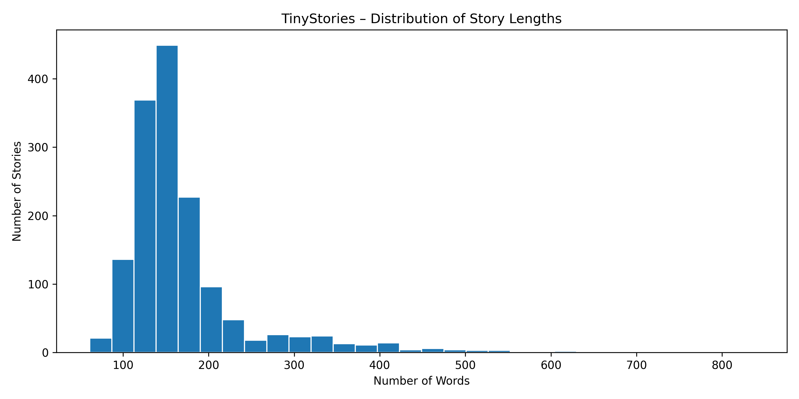
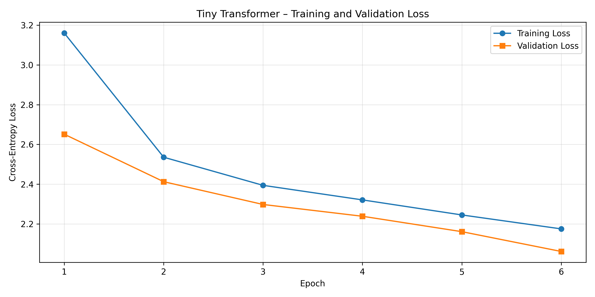
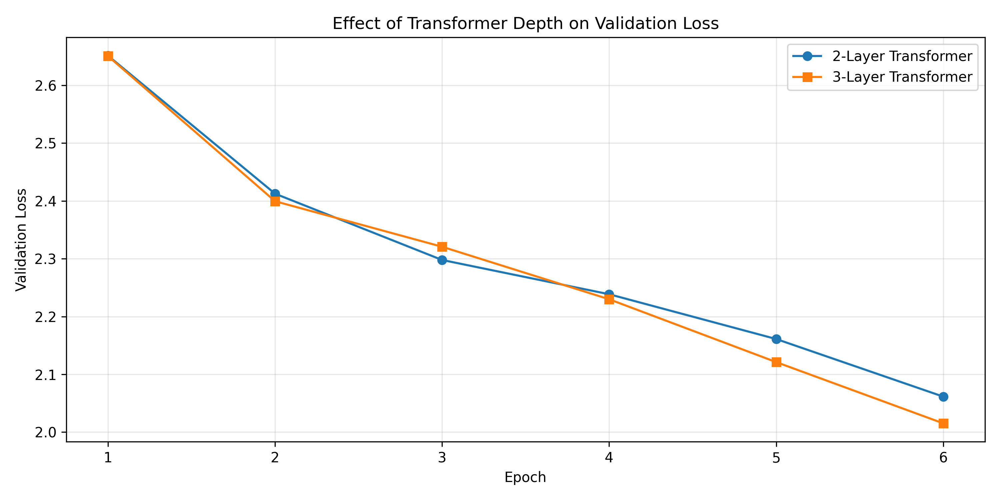

# Lab 03 – Developing a Tiny Transformer Language Model

**Module:** PUSL3205 – Large Language Models and Generative AI  
**Laboratory:** 03 – Developing a Tiny Transformer Language Model  
**Language and framework:** Python, PyTorch  
**Environment:** Google Colab (NVIDIA Tesla T4 GPU)  
**Dataset:** [TinyStories – `roneneldan/TinyStories`](https://huggingface.co/datasets/roneneldan/TinyStories)

## 1. Laboratory session

In this lab, I built a small Transformer language model that learns to predict the next character in a story. I used a subset of TinyStories because its short, simple stories make it a useful starting point for experimenting with text generation without needing to train a large language model.

The work covered the main stages of language modelling: loading stories, converting characters into tokens, preparing input–target pairs, defining a decoder-only Transformer, training it and evaluating the results. I also compared a two-layer model with a three-layer model to see whether making the network deeper helped under the same training budget.

The full implementation and executed cell outputs are in [`notebooks/LabSheet_3.ipynb`](notebooks/LabSheet_3.ipynb).

## 2. Objective

The aim was to understand how a Transformer can learn from sequences and produce text one character at a time. The practical specifically involved:

- Exploring a subset of the TinyStories dataset.
- Building a character-level vocabulary and next-character training examples.
- Implementing token and positional embeddings, causally masked multi-head attention, feed-forward networks, residual connections and layer normalisation.
- Training a model with cross-entropy loss and the AdamW optimiser.
- Tracking training and validation losses and measuring character-level perplexity.
- Generating stories from text prompts and comparing model settings.
- Saving the trained weights, vocabulary and configuration for reuse.

## 3. Tools and setup

| Tool | How it was used |
|---|---|
| Python | Main programming language |
| Google Colab | Running the notebook and GPU training |
| PyTorch | Defining and training the Transformer |
| Hugging Face `datasets` | Streaming TinyStories examples |
| NumPy and Pandas | Calculations, summaries and experiment tables |
| Matplotlib | Story-length and loss-curve plots |
| JSON and PyTorch checkpoint utilities | Saving configuration, vocabulary and model weights |

The executed notebook reports **PyTorch 2.14.1+cu130** and an **NVIDIA Tesla T4** GPU. I used a fixed random seed of `42` to make the experiment more reproducible, although some variation is still possible with random batch sampling and GPU execution.

## 4. Tasks and implementation

### 4.1 Loading and exploring the dataset

I streamed the `train` split of `roneneldan/TinyStories` and selected the first **1,500 non-empty stories** returned by the stream. The notebook displays examples before moving on to tokenisation.

| Story-length measure | Words | Characters |
|---|---:|---:|
| Mean | 169.52 | 867.30 |
| Median | 150.00 | 775.50 |
| Minimum | 61 | 274 |
| Maximum | 837 | 4,123 |

Most stories in the selected subset were relatively short, but their lengths varied considerably. This was one reason for using fixed-length training sequences rather than trying to process entire stories at once.

### 4.2 Preprocessing and character-level tokenisation

Before joining the stories into longer text sequences, I shuffled their indices with seed `42` and divided them into training and validation groups. Keeping the split at the **story level** helps avoid placing overlapping sequences from the same story in both sets.

| Data preparation | Recorded result |
|---|---:|
| Training stories | 1,350 |
| Validation stories | 150 |
| Training characters | 1,175,835 |
| Validation characters | 126,619 |
| Vocabulary size | 78 token IDs |
| Unknown characters in the validation text | 0 |

The tokenizer maps each character to an integer using `stoi` and converts IDs back to text using `itos`. Token ID `0` is reserved for unknown characters. A sample phrase, `Once upon a time`, was encoded and decoded correctly in the notebook.

I chose character-level modelling because it keeps tokenisation simple and makes it easier to see exactly what the network is predicting. The drawback is that the model has to learn spelling and word boundaries from individual characters, which is harder than predicting from a pretrained subword vocabulary.

### 4.3 Preparing next-character training sequences

The input is a sequence of characters, and the target is that sequence shifted by one position. For example, an input such as `hell` would have `ello` as its target. In this experiment, batches were sampled randomly from the encoded text.

| Setting | Value |
|---|---:|
| Batch size | 32 |
| Context / block size | 128 characters |
| Input batch shape | `(32, 128)` |
| Target batch shape | `(32, 128)` |

The notebook prints an actual input sequence and its shifted target, confirming that the target characters are one position ahead.

### 4.4 Transformer architecture

I implemented a **decoder-only Transformer** in PyTorch. Its components are:

1. **Token embeddings** to represent character IDs as vectors.
2. **Positional embeddings** to show where characters occur in the sequence.
3. **Multi-head self-attention** to model relationships between characters.
4. **A causal attention mask** to prevent access to future characters.
5. **Feed-forward layers** for additional nonlinear processing.
6. **Residual connections and layer normalisation** to support stable learning.
7. **A linear output layer** that produces scores over the character vocabulary.

The causal mask is particularly important. Without it, the model could use characters that it was supposed to predict, making the task invalid.

The baseline configuration was:

| Parameter | Value |
|---|---:|
| Embedding dimension | 128 |
| Attention heads | 4 |
| Transformer layers | 2 |
| Dropout | 0.1 |
| Vocabulary size | 78 |
| Context length | 128 |
| Trainable parameters | **433,230** |

### 4.5 Initialisation and training

I used cross-entropy loss for next-character prediction and the AdamW optimiser to update the model weights. Gradient clipping (`max_norm=1.0`) was applied during training.

| Training setting | Value |
|---|---:|
| Learning rate | 0.0003 |
| Weight decay | 0.01 |
| Epochs in the notebook | 6 |
| Training steps per epoch | 60 |
| Batch size | 32 |
| Evaluation batches during training | 12 |

**Important detail:** Here, an “epoch” means **60 randomly sampled mini-batches**, not a complete pass through every possible sequence in TinyStories. The model was therefore trained for a deliberately limited number of updates. This matters when interpreting the output quality.

### 4.6 Monitoring the loss

The baseline model's recorded losses decreased over the six training epochs:

| Epoch | Training loss | Validation loss |
|---|---:|---:|
| 1 | 3.1599 | 2.6512 |
| 2 | 2.5356 | 2.4125 |
| 3 | 2.3941 | 2.2979 |
| 4 | 2.3209 | 2.2386 |
| 5 | 2.2452 | 2.1611 |
| 6 | **2.1751** | **2.0615** |

Both losses went down, showing that the model learned some patterns in the text. The validation loss did not show an obvious increase during this short run, although six sampled epochs are not enough to make a broad claim about overfitting.

### 4.7 Validation loss and perplexity

After training, the notebook ran another evaluation using 40 randomly sampled batches. The recorded baseline results were:

| Metric | Value |
|---|---:|
| Training loss | 2.0790 |
| Validation loss | **2.0664** |
| Character-level perplexity | **7.8966** |

Perplexity was calculated as `exp(validation loss)`. Lower values indicate that the model assigned more probability to the correct next characters. This is **character-level perplexity**; it should not be directly compared with the perplexity of models that predict words or subword tokens.

The later two-model comparison sampled validation batches again, producing a slightly different baseline loss. This is expected with the notebook's random-batch evaluation method and is reported separately below.

### 4.8 Generating stories

I tested the baseline model with the prompts `Once upon a time` and `There was a little girl`, generating 300 additional characters for each prompt.

A short extract from the first output was:

> Once upon a timecelelle ay. Suld ara bok loucy bre.

The text contains some recognisable fragments, but many words are misspelled or invented, and the sentences do not form a clear story. The second prompt showed similar problems.

This was a useful result to keep rather than hide. The falling loss values show progress in next-character prediction, but they **do not mean the model has learned to produce coherent stories**. With a small model, character-level tokens and a short training budget, the generated text remained limited.

The complete recorded examples are saved by the notebook to `results/05-generated-stories.txt`.

### 4.9 Experiment: two layers versus three layers

To test the effect of model depth, I created a second Transformer with **three layers** instead of two. The attention-head count, embedding size, data split, optimiser settings and scheduled number of training steps remained the same.

The final comparison recorded in the notebook was:

| Model | Layers | Heads | Trainable parameters | Validation loss | Perplexity |
|---|---:|---:|---:|---:|---:|
| Baseline Transformer | 2 | 4 | 433,230 | 2.0697 | 7.9222 |
| Deeper Transformer | 3 | 4 | 631,502 | **2.0227** | **7.5585** |

The three-layer model used **198,272 additional parameters**, approximately **46% more** than the baseline. Its validation loss was lower by **0.0470**, and its perplexity was also lower.

The deeper model performed a little better on this validation measure, but it still generated largely incoherent text. An extract from its recorded output begins:

> Once upon a time i was, thn the aorhe bend win to we is to haplinthe...

The results suggest that extra depth helped the model fit character patterns under these settings, but the improvement in numerical scores was modest and did not solve the readability problem. This is a **single short comparison**, so it does not establish that three layers will always be better.

### 4.10 Saving and verifying the models

The notebook saved both trained models along with the configuration and character vocabulary. It then reconstructed the baseline network and successfully loaded its saved state dictionary.

| Saved file | Purpose |
|---|---|
| `saved-model/tiny_transformer_2layers.pt` | Baseline model weights |
| `saved-model/tiny_transformer_3layers.pt` | Experimental model weights |
| `saved-model/config.json` | Architecture, training settings and metrics |
| `saved-model/vocabulary.json` | Character vocabulary and unknown-token information |

The executed notebook reports **“Baseline model reloaded successfully.”** This confirms that the checkpoint could be read and applied to the reconstructed network in that runtime. It does not by itself demonstrate generation in a completely fresh environment.

## 5. Results and evidence

The main results are summarised below.

| Evidence | Finding |
|---|---|
| Dataset exploration | 1,500 selected stories; mean length 169.52 words |
| Tokenisation | 78 token IDs; no unknown characters in validation |
| Input/target preparation | Matched `(32, 128)` batches with shifted targets |
| Baseline training | Validation loss decreased from 2.6512 to 2.0615 across the epoch logs |
| Baseline evaluation | Validation loss 2.0664; perplexity 7.8966 |
| Architecture comparison | Three layers: 2.0227 validation loss vs 2.0697 for two layers in the comparison run |
| Story generation | Character patterns emerged, but complete stories were not coherent |
| Model saving | Both models saved; baseline weights successfully reloaded |

**Files generated by the notebook:**

- `results/01-story-length-distribution.png`
- `results/story-length-statistics.csv`
- `results/02-training-history.csv`
- `results/03-training-validation-loss.png`
- `results/04-evaluation-results.json`
- `results/05-generated-stories.txt`
- `results/06-experiment-training-history.csv`
- `results/07-model-comparison.csv`
- `results/08-model-depth-comparison.png`
- `results/09-experiment-generated-story.txt`
- The four model files listed in Section 4.10

**Screenshots:** Store genuine captures of the dataset, tokenisation, model configuration, training logs, loss curves, perplexity, generated stories, experiment comparison and model reload in `screenshots/`. These screenshots are separate evidence and should only be linked here after they have been added to the repository.

## 6. Observations and discussion

The most useful thing I noticed was the gap between **learning to predict characters** and **learning to write a readable story**. The loss curves moved in the right direction, and the three-layer experiment improved perplexity slightly. However, the generated text was still difficult to understand. That made it clear that a lower loss does not automatically translate into fluent language generation, especially after such limited training.

The comparison also showed a practical trade-off. Adding a third layer increased the parameter count by about 46% while reducing validation loss only modestly. A larger network can learn more complex patterns, but it also requires more computation, and extra parameters alone do not guarantee high-quality output.

I also found the character-level representation useful for understanding the process. It is straightforward to build and inspect, but it makes the model responsible for constructing words character by character. A larger training budget, more carefully tuned settings or subword tokenisation would be reasonable directions to investigate next.

### Limitations

- **Limited training:** Six rounds of 60 sampled steps are not six full passes through the dataset.
- **Limited data:** Only 1,500 stories were selected from TinyStories.
- **Character-level output:** The model must learn spelling, spacing and language structure from individual characters.
- **Short context:** The 128-character context window restricts how much preceding text the model can consider at once.
- **Approximate validation metrics:** Loss was estimated on randomly sampled batches, so repeated evaluations can differ slightly.
- **Single architecture comparison:** The depth experiment was run once; repeated trials would be needed to assess consistency.
- **No semantic quality metric:** Perplexity evaluates next-character prediction, not whether the generated stories make sense to a reader.

## 7. Mechanisms used to improve training and generation

The model incorporated several mechanisms that were relevant to this task:

| Mechanism | Why it mattered |
|---|---|
| Causal attention mask | Prevented future-character information from leaking into predictions |
| Multi-head self-attention | Let the model learn multiple relationships within the context window |
| Positional embeddings | Supplied information about character order |
| Residual connections | Helped information and gradients move through the Transformer blocks |
| Layer normalisation | Supported more stable activations during training |
| Dropout and weight decay | Added regularisation to reduce overfitting risk |
| Gradient clipping | Limited excessively large gradient updates |
| Temperature and top-k sampling | Controlled the diversity of generated characters, without changing the trained weights |

These techniques supported the learning process, but they did not remove the limitations created by the small model and short training budget.

## 8. Learning outcomes

This lab helped me understand the Transformer at the implementation level rather than only as a diagram. I worked with token IDs, shifted targets, attention masks, model weights, training loops and generated sequences in the same notebook.

The key lessons from the recorded experiment were that the causal mask is essential for valid next-token learning, the way a dataset is split matters, and training loss, validation loss and generated-text quality answer different questions. I also learned how to compare two model configurations while keeping most settings fixed and how to save enough information to reconstruct a model later.

## 9. Conclusion

I completed the main Tiny Transformer lab tasks: prepared TinyStories text, implemented and trained a causal Transformer, measured its validation performance, generated text, compared two model depths and saved the trained weights.

The experiment showed measurable learning. The three-layer model achieved a lower validation loss (**2.0227**) than the two-layer model (**2.0697**) in the final comparison. At the same time, both models struggled to generate coherent stories. For me, that was the clearest outcome of this practical: **a model can improve at predicting the next character without yet becoming a good storyteller**.

## 10. References

1. Hugging Face. [TinyStories dataset (`roneneldan/TinyStories`)](https://huggingface.co/datasets/roneneldan/TinyStories).
2. Eldan, R. and Li, Y. (2023). [*TinyStories: How Small Can Language Models Be and Still Speak Coherent English?*](https://arxiv.org/abs/2305.07759).
3. Vaswani, A. et al. (2017). [*Attention Is All You Need*](https://arxiv.org/abs/1706.03762).
4. PyTorch. [MultiheadAttention documentation](https://pytorch.org/docs/stable/generated/torch.nn.MultiheadAttention.html).
5. PyTorch. [CrossEntropyLoss documentation](https://pytorch.org/docs/stable/generated/torch.nn.CrossEntropyLoss.html).

