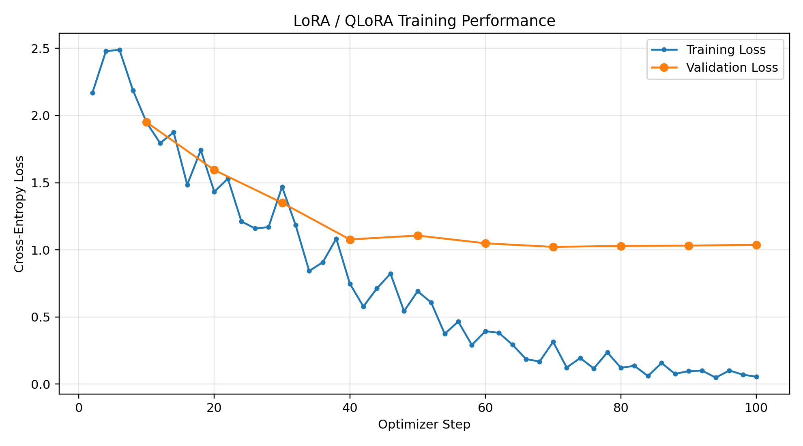

# Lab 04 — Fine-Tuning an LLM with QLoRA

**Module:** PUSL3205 — Large Language Models and Generative AI  
**Laboratory:** 04 — Fine-Tuning an LLM Using LoRA/QLoRA  
**Environment:** Google Colab · Python · PyTorch  
**Base model:** [`Qwen/Qwen2.5-0.5B-Instruct`](https://huggingface.co/Qwen/Qwen2.5-0.5B-Instruct)  
**Experiment:** A question-and-answer assistant for a fictional computer shop

## 1. Laboratory session

For this lab, I worked with a small instruction-tuned language model and tried to make it answer questions about a particular business. I used a fictional shop, **ByteBridge Computers**, so I could decide exactly which policies the model should know and check its answers against those policies later.

The main idea was to see what could be achieved without retraining an entire language model. I used **4-bit QLoRA**, which keeps the pretrained model in a memory-efficient format and trains a relatively small set of adapter parameters. I then asked the original and fine-tuned versions the same ten questions to see what had actually changed.

The result was mixed. Fine-tuning helped the model remember some shop facts, but it did **not** make the assistant consistently accurate. That difference between a successful training run and a reliable answer is the main takeaway from this experiment.

## 2. Objectives

The practical was intended to help me:

- Check the GPU available in Colab and understand why GPU memory matters during fine-tuning.
- Choose a small instruction-tuned model that could be trained with the available hardware.
- Prepare at least 30 domain-specific question-and-answer examples.
- Configure LoRA through the PEFT library, with 4-bit quantisation to reduce memory usage.
- Carry out supervised fine-tuning with TRL's `SFTTrainer`.
- Compare the original and fine-tuned model using exactly the same questions, including questions not used for training.
- Save the trained adapter and check that it could be loaded again.

## 3. Tools and environment

| Item | Used in this experiment |
|---|---|
| Development environment | Google Colab |
| GPU | NVIDIA Tesla T4 |
| GPU memory reported in Colab | 14.56 GiB |
| Base model | `Qwen/Qwen2.5-0.5B-Instruct` |
| Fine-tuning approach | QLoRA, with 4-bit NF4 quantisation |
| Main libraries | `transformers`, `datasets`, `peft`, `trl`, `accelerate`, `bitsandbytes`, PyTorch |
| Analysis | Pandas and Matplotlib |
| Random seed | 42 |

The T4 was useful because training involves many matrix calculations and storing model activations and gradients. I also learned that having a GPU does not automatically mean every numerical precision or training implementation will work on it. Several of the issues I encountered were related to that distinction.

## 4. Dataset preparation

I created **40 training Q&A pairs** for ByteBridge Computers. This is a fictional business, and its policies in the dataset are made up for the experiment; they are not details about a real shop.

The questions cover ordinary customer enquiries such as opening hours, delivery charges, warranties, laptop repairs, returns, student discounts and instalment payments. Keeping the domain fairly narrow made it possible to check whether the model answered according to the supplied facts rather than simply producing a plausible response.

The data was divided as follows:

| Set | Number of examples | Purpose |
|---|---:|---|
| Training | 40 | Used to update the LoRA adapter |
| Validation | 4 | Used to monitor performance during training |
| Unseen test questions | 10 | Used for the before/after response comparison |

The validation and test questions used different wording from the training questions. The final test contained **eight known-policy questions** and **two questions asking for information the dataset did not provide**. The latter were useful for checking whether the model would admit that it lacked information.

Some of the policies used in the experiment were:

| Policy | Expected information |
|---|---|
| Sunday opening | Closed on Sundays |
| Free delivery | Orders worth **LKR 25,000 or more** |
| Pickup time | Usually within **24 hours** after confirmation |
| Laptop diagnostic charge | **LKR 1,500** |
| Student discount | **5% on eligible accessories**, not laptops |
| Instalment payments | Not available |
| Used-item trade-ins | Not accepted |

The saved datasets are located in [`dataset/`](dataset/).

## 5. Tasks and implementation

### 5.1 Choosing the model

I selected **Qwen2.5-0.5B-Instruct**, one of the smaller instruction-tuned models suggested for the lab. It was practical for this experiment because it could be loaded on the Colab T4 using reduced precision and 4-bit quantisation.

The model and its tokenizer were loaded from Hugging Face. A short system prompt told the assistant to answer questions about the fictional shop and avoid inventing details when information was unavailable. The same prompt and deterministic generation settings were used for the original-model test and the fine-tuned-model test.

### 5.2 Testing the original model

I tested the original model **before fine-tuning** and saved its responses. This gave me a baseline rather than assuming the adapter would improve everything.

The original model generally did not know the fictional shop's policies. For example, it said customers could visit on Sunday even though the shop was supposed to be closed. For the diagnostic fee, it gave a general price range in US dollars instead of the specified LKR 1,500.

For the manager's private phone number, however, it appropriately indicated that the information was unavailable. That was a better response than inventing a number.

These responses are saved in [`results/original-model-answers.json`](results/original-model-answers.json).

### 5.3 Configuring LoRA and QLoRA

I used PEFT to add LoRA adapters to the model's attention projection layers. The main settings were:

| Setting | Value |
|---|---|
| Quantisation | 4-bit NF4 |
| LoRA rank (`r`) | 16 |
| LoRA alpha | 32 |
| LoRA dropout | 0.05 |
| Target modules | `q_proj`, `k_proj`, `v_proj`, `o_proj` |
| Trainable parameters | **2,162,688** |
| Total reported parameters | **496,195,456** |
| Trainable proportion | **0.4359%** |

Only a small fraction of the reported parameters needed to be updated. The main advantage here was being able to adapt the model without performing full-parameter fine-tuning.

### 5.4 Supervised fine-tuning

The training examples were formatted as instruction-and-answer conversations, and the model was trained using TRL's `SFTTrainer`.

| Training setting | Recorded configuration |
|---|---|
| Epochs | 10 |
| Learning rate | `2e-4` |
| Per-device training batch size | 2 |
| Gradient accumulation steps | 2 |
| Optimiser steps | 100 |
| Loss type | Standard NLL |
| Training mixed precision | FP16 |
| Trainable adapter weight precision after compatibility fix | FP32 |

I had to work through several library and GPU compatibility problems before the training run completed. The significant ones were an update to the chat-template return type, changes in TRL training arguments, a loss computation that did not work on the T4, and BF16 gradients reaching the FP16 gradient scaler.

The working run used standard NLL loss, FP16 training on the T4 and FP32 trainable LoRA parameters while retaining 4-bit quantisation for the base model. **I did not convert the full model to FP32.**

The recorded training finished all ten epochs and reached **100 optimiser steps**.

## 6. Training results

The trainer reported an **overall training loss of 0.7887**. The final validation loss was **1.0382**. The lowest validation loss appeared at **epoch 7**, at approximately **1.0221**.

The distinction matters: the reported overall training loss is not the same as the final mini-batch training loss shown at the end of the progress table.

### Validation performance by epoch

| Epoch | Training loss reported at epoch | Validation loss |
|---:|---:|---:|
| 1 | 1.9483 | 1.9500 |
| 2 | 1.4326 | 1.5943 |
| 3 | 1.4694 | 1.3505 |
| 4 | 0.7482 | 1.0775 |
| 5 | 0.6920 | 1.1065 |
| 6 | 0.3945 | 1.0488 |
| **7** | **0.3153** | **1.0221** |
| 8 | 0.1219 | 1.0290 |
| 9 | 0.0979 | 1.0312 |
| 10 | 0.0555 | 1.0382 |

The training loss continued to fall towards the end, but the validation loss stopped improving after epoch 7 and increased slightly. This suggests that the extra training was helping the model fit the small training dataset more closely without improving validation performance.

I would not treat that as definite proof of overfitting, though, because there were only **four validation examples**. A larger validation set would give a more reliable picture.



*Figure: Recorded training and validation loss during QLoRA fine-tuning.*

The training log is available in [`results/training-history.csv`](results/training-history.csv), and the experiment summary is in [`results/experiment-summary.json`](results/experiment-summary.json).

## 7. Original model vs fine-tuned model

This comparison was the most useful part of the practical. I used the **same ten questions** for both models and compared the answers with the expected shop policy or with the fact that the information was unavailable.

Below is my review of the recorded answers. These are **manual judgments**, not an automatic benchmark score. I counted an answer as acceptable when it gave the key policy correctly or appropriately acknowledged unavailable information. Contradictory or invented information was treated as a weakness even when a response included some correct wording.

| # | Question topic | Original model | Fine-tuned model | What I observed |
|---:|---|---|---|---|
| 1 | Sunday opening | Incorrect | Mostly correct | The fine-tuned answer said the shop was closed, although it awkwardly began with “Yes.” |
| 2 | Free-delivery threshold | Incorrect | Correct | It learned **LKR 25,000**. |
| 3 | Pickup time | Incorrect | Incorrect | It gave a 48-hour-related answer instead of pickup within 24 hours. |
| 4 | Returns after opening | Incorrect | Incorrect | It talked about changing a purchase before submitting it, not the actual return policy. |
| 5 | Laptop student discount | Incorrect overall | Mostly correct | It correctly said laptops do not receive the discount, but omitted the eligible-accessories detail. |
| 6 | Monthly instalments | Incorrect | Incorrect | It invented an instalment plan despite the dataset saying none was available. |
| 7 | Diagnostic charge | Incorrect | Correct | It gave **LKR 1,500** instead of the original model's generic dollar range. |
| 8 | Trade-ins | Incorrect | Incorrect | It still suggested accepting used items. |
| 9 | Manager's personal number | Appropriate uncertainty | Appropriate uncertainty | Neither response invented a personal phone number. |
| 10 | Current laptop stock | Fabricated | Incorrect / unsupported | Neither model acknowledged that live inventory was not supplied. |

Under this deliberately simple manual scoring approach, approximately **1 of 10** original responses and **5 of 10** fine-tuned responses were acceptable. The five fine-tuned responses include partial or awkward answers where the central point was correct; a stricter assessment could score them lower.

This was a small set of hand-selected tests, so these numbers are **not** a general accuracy measurement for the model.

### Examples that stood out

**A clear improvement — delivery charges.** The original model misunderstood the question about free shipping. After fine-tuning, it identified the shop's actual threshold of **LKR 25,000**.

**Another improvement — laptop diagnostics.** The original model guessed a price range in dollars. The fine-tuned model answered **LKR 1,500**, matching the training information.

**A serious remaining error — instalments.** The dataset explicitly said that monthly instalment payments were not offered, but the fine-tuned model claimed that the shop offered them. It even added an unsupported discount. That is the kind of mistake that would be a real problem in a customer-facing assistant.

**A problem with missing information — stock availability.** Neither version reliably said it could not know today's laptop inventory. The fine-tuned model produced an incoherent hardware-style description instead of admitting the limitation.

The complete recorded comparison is saved in [`results/original-vs-finetuned.csv`](results/original-vs-finetuned.csv).

## 8. Observations and discussion

There are three things I would take from these results.

First, **fine-tuning did change what the model knew about the shop**. The improvement on the free-delivery threshold and diagnostic price was clear. That is evidence that the adapter learned at least some of the domain-specific examples.

Second, **a low training loss is not the same as a dependable assistant**. The training run completed, and the validation loss decreased substantially, but the model still made mistakes about returns, instalments and trade-ins. In some cases, the answer sounded confident even though it was factually wrong.

Third, the model struggled when it was asked about information that was not provided. A fictional shop assistant should not invent current stock details or private contact information. A stronger system would need more examples of when to refuse to guess or say that information is unavailable.

I also noticed that some wrong answers mixed together facts from different parts of the dataset. For example, the response about pickup time referred to 48 hours, a duration associated with reservations in the training policies. That suggests the model had learned pieces of the shop information without consistently matching them to the right questions.

## 9. Challenges and limitations

### Technical challenges

This experiment took some debugging before training worked on the Colab T4. The issues included:

- Missing imports for some Hugging Face classes in an early notebook cell.
- A change in the object returned by the tokenizer's chat-template method.
- TRL configuration arguments that differed from those used in the initial setup.
- A BF16-related matrix operation that was incompatible with the T4.
- BF16 adapter gradients conflicting with FP16 gradient scaling.

The successful run was achieved by adjusting the training configuration and adapter precision, not by abandoning QLoRA.

### Limitations of the experiment

- **Very small dataset:** Forty training examples are not enough to cover many different ways customers might ask about the same policy.
- **Small validation set:** Four examples make validation loss sensitive to the particular questions chosen.
- **Limited test set:** Ten questions are useful for a lab comparison but do not establish overall reliability.
- **Fictional information:** The shop facts were created for the experiment and are not verified business data.
- **No live information source:** Fine-tuning cannot supply current inventory or other changing information that was never provided.
- **Inconsistent answers:** The fine-tuned model still produced unsupported or contradictory responses.

If I extended the experiment, I would first expand the dataset with more paraphrases and negative examples such as “Do you offer instalments?” / “No, instalments are not available.” I would also add explicit examples of how to respond when information is missing, use a larger validation set, and compare the results before and after those changes.

For a real shop assistant, retrieval from a maintained policy or inventory source would be worth investigating. That could provide up-to-date facts without relying entirely on information memorised during fine-tuning.

## 10. Saved adapter and project evidence

After training, the LoRA adapter was saved separately from the base model. The notebook records the following adapter-related files:

- `saved-adapter/adapter_model.safetensors`
- `saved-adapter/adapter_config.json`
- `saved-adapter/tokenizer.json`
- `saved-adapter/tokenizer_config.json`
- `saved-adapter/chat_template.jinja`

The notebook also shows a successful adapter reload. When the reloaded model was asked about Sunday opening, it again stated that the shop was closed. This provides evidence that the saved adapter could be loaded for inference without retraining.

### Folder layout

```text
Lab-04-LoRA-Fine-Tuning/
├── README.md
├── notebooks/
│   └── LabSheet_4.ipynb
├── dataset/
│   ├── training_qa.jsonl
│   ├── validation_qa.jsonl
│   └── unseen_test_questions.json
├── results/
│   ├── original-model-answers.json
│   ├── training-history.csv
│   ├── training-loss.png
│   ├── original-vs-finetuned.csv
│   └── experiment-summary.json
├── screenshots/
│   └── (screenshots of the executed work)
└── saved-adapter/
    └── (LoRA adapter and tokenizer files)
```

The [`notebook`](notebooks/LabSheet_4.ipynb) is the primary implementation record. The [`results/`](results/) folder contains the exported outputs, and [`screenshots/`](screenshots/) provides visual evidence of the main steps.


## 11. Learning outcomes

This lab gave me practical experience with a part of LLM development that is easy to underestimate: getting a model to train is only one stage of the work.

I learned how a small, structured Q&A dataset can be used for instruction fine-tuning; how LoRA reduces the number of trainable parameters; and why GPU precision and library compatibility matter in practice. I also learned to evaluate a fine-tuned model by comparing its actual answers, not just its training loss.

The result I found most useful was that the model could correctly remember some new facts and still confidently invent others. That made the limitations of small-data fine-tuning much clearer.

## 12. Conclusion

I successfully fine-tuned Qwen2.5-0.5B-Instruct using a 4-bit QLoRA setup on a Tesla T4, completed ten epochs of supervised training, compared ten before-and-after responses, and saved and reloaded the LoRA adapter.

The model improved on a number of shop-specific questions. However, it was still unreliable on several important policies, particularly instalment payments, returns and trade-ins. The experiment therefore shows both **what parameter-efficient fine-tuning can achieve with limited resources** and **why careful testing is necessary before using the resulting model in a real application**.

## 13. References

1. PUSL3205 — *Lab Sheet 04: Fine-Tuning an LLM Using LoRA/QLoRA* (module-provided practical sheet).
2. [Qwen2.5-0.5B-Instruct — Hugging Face model page](https://huggingface.co/Qwen/Qwen2.5-0.5B-Instruct).
3. [Hugging Face PEFT documentation](https://huggingface.co/docs/peft/index).
4. [Hugging Face TRL — SFTTrainer documentation](https://huggingface.co/docs/trl/sft_trainer).
5. [Hugging Face Transformers documentation](https://huggingface.co/docs/transformers/index).

---
