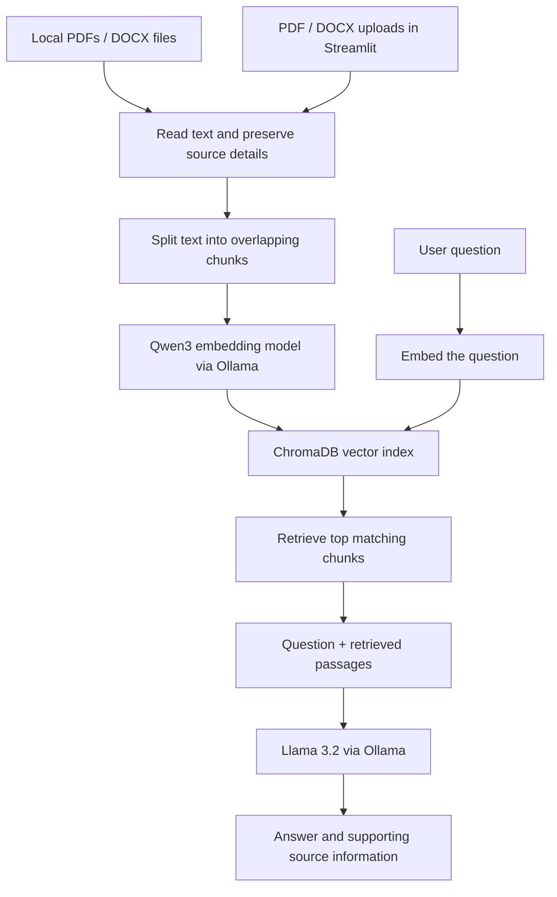
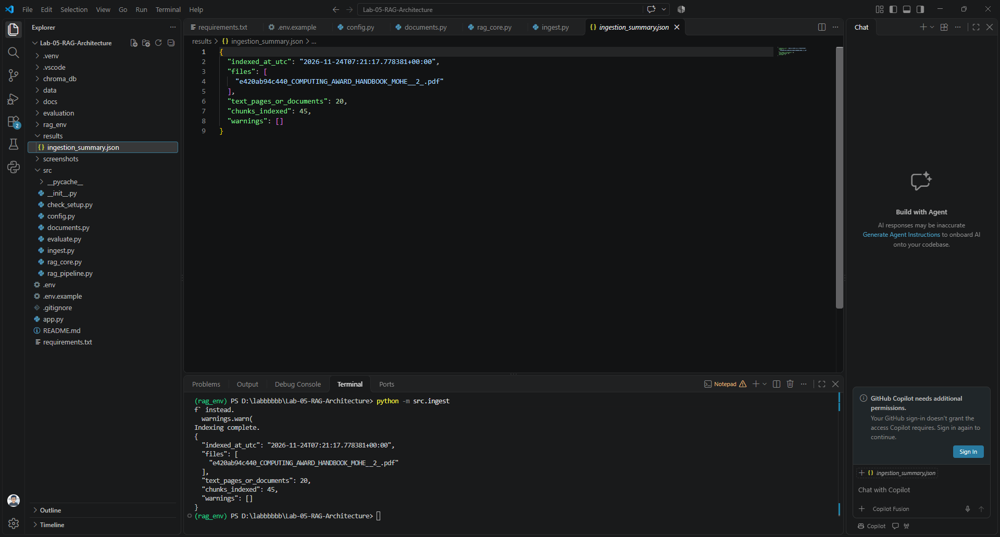
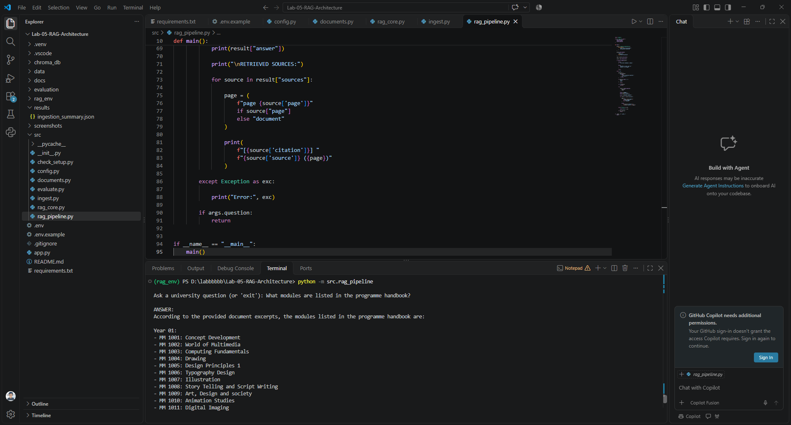
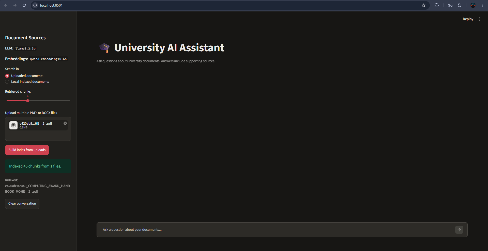
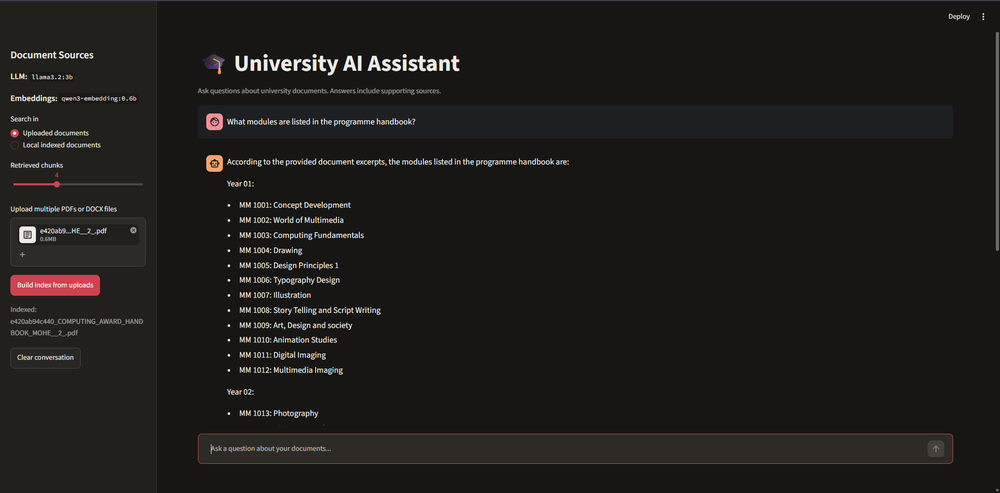

# Lab 05 — University Document Question Answering with RAG

**Module:** PUSL3205 – Large Language Models and Generative AI  
**Lab:** 05 – RAG Architecture  
**Development environment:** Visual Studio Code, Python 3.12, Windows  
**Tools:** LangChain, Ollama, ChromaDB, Streamlit, PyMuPDF

## 1. Laboratory session

For this lab, I worked on a local question-answering assistant that uses information from university documents instead of relying only on what a language model already knows. The idea is straightforward: upload a handbook, ask a question, find the relevant passages, and use those passages to prepare an answer.

The application is called **University AI Assistant**. I built a terminal version first and then a Streamlit interface where documents can be uploaded and questions can be asked through a chat window. The project is based on the RAG architecture covered in Lab Sheet 05.

I used an NSBM Computing Awards Handbook as my test document. I kept the work local using Ollama rather than connecting to a paid LLM API.

## 2. Objective

My main objective was to understand how **Retrieval-Augmented Generation (RAG)** works in a practical application, from extracting PDF text to retrieving relevant information and generating a response.

The work covered:

- Setting up the Python environment and local Ollama models.
- Reading PDF and DOCX files and dividing their text into smaller chunks.
- Creating document embeddings and storing them in ChromaDB.
- Retrieving relevant chunks for a user's question.
- Generating an answer with a local LLM and exposing the supporting document references.
- Creating both a command-line interface and a Streamlit web interface.
- Supporting user uploads through the application, instead of requiring every document to be added to the project folder manually.

## 3. Tools used

| Tool | Where I used it |
|---|---|
| Python 3.12 | Main application code |
| VS Code | Editing and running the project |
| LangChain | Connecting the document, retrieval, and model components |
| Ollama + `llama3.2:3b` | Generating answers locally |
| Ollama + `qwen3-embedding:0.6b` | Converting text and questions into embeddings |
| ChromaDB | Storing and retrieving document vectors |
| PyMuPDF | Extracting text from PDF pages |
| `python-docx` | Reading DOCX files |
| Streamlit | Upload interface and document chat |

The model and embedding names are configured in [`.env.example`](.env.example), rather than being hard-coded into each script.

## 4. How the application works

The PDF is **not** used to retrain Llama 3.2. Instead, its contents are retrieved at question time and included in the prompt sent to the model.



The configuration used in the submitted project is:

| Setting | Value |
|---|---|
| Language model | `llama3.2:3b` |
| Embedding model | `qwen3-embedding:0.6b` |
| Chunk size | 900 characters |
| Chunk overlap | 150 characters |
| Retrieved chunks | Top 4 by default |
| Vector collection | `university_documents` |

For local documents, the index is saved under `chroma_db/`. The Streamlit upload path creates a separate temporary index so uploaded files do not overwrite the locally indexed handbook.

## 5. Tasks and implementation

### 5.1 Setting up the environment

I used Python 3.12 and created a virtual environment to keep the required libraries separate from my other projects. I ran into an installation issue because `requirements.txt` was initially empty; when I tried to fix it, some PowerShell commands ended up inside the file and `pip` rejected them. The file was corrected to contain package names only.

The local environment folder (`rag_env`) was **removed from the submission** because it occupied roughly 1.6 GB. Python environments contain installed dependencies, not the original project implementation, so there is no reason to store them in GitHub. The smaller `.venv` folder that remains in the original exported ZIP should also be excluded from the final repository.

### 5.2 Loading and splitting documents

In [`src/documents.py`], PDFs are read page by page with PyMuPDF. The extracted text is stored with its original filename and page number. DOCX files are also supported.

After extraction, `RecursiveCharacterTextSplitter` creates overlapping chunks. Splitting is necessary because sending an entire handbook to the model for every question would be inefficient, and the model has a limited context window.

A limitation here is that scanned or image-only PDFs are not automatically processed with OCR.

### 5.3 Building the document index

[`src/ingest.py`](src/ingest.py) reads supported files from `data/`, converts the text into chunks, and stores their embeddings in ChromaDB through [`src/rag_core.py`](src/rag_core.py).

The ingestion script also creates [`results/ingestion_summary.json`](results/ingestion_summary.json), which records the number of files and indexed chunks. The saved summary is the evidence for the dataset figures reported below.



*Figure 1. Successful local ingestion and the recorded JSON summary in VS Code.*

### 5.4 Asking questions from the terminal

[`src/rag_pipeline.py`](src/rag_pipeline.py) provides a command-line interface. After indexing a document, I could type a university-related question and receive a generated answer together with retrieved source details.

One question I tried was:

> What modules are listed in the programme handbook?

The terminal response listed module codes and names such as **MM 1001 – Concept Development**, **MM 1002 – World of Multimedia**, and **MM 1003 – Computing Fundamentals**. These examples appear in the multimedia programme-content table on page 19 of the handbook.



*Figure 2. A document-based question answered through the terminal RAG pipeline.*

### 5.5 Building the Streamlit interface

[`app.py`](app.py) gives the project a simple chat interface. It includes:

- A document upload control for PDF and DOCX files.
- A choice between locally indexed documents and uploaded documents.
- A slider for the number of retrieved chunks.
- A conversation window and an option to clear the chat.
- Expandable supporting excerpts with source filenames and PDF page numbers.

The application code accepts multiple files in one upload operation. In the screenshots submitted with this project, I demonstrated the upload and indexing flow with **one PDF**. Multiple simultaneous PDF uploads have not yet been documented as a separate completed test.



*Figure 3. Streamlit interface showing the selected handbook and an indexed upload.*



*Figure 4. A handbook question answered in the Streamlit chat interface.*

### 5.6 Handling retrieved evidence

The RAG core requests the most similar document chunks from ChromaDB and sends those passages to Llama 3.2 with instructions to stay within the supplied evidence. Source filenames and page numbers are retained so the retrieved passages can be inspected.

This is useful, but the prompt alone cannot guarantee factual answers. A relevant-looking chunk may still be incomplete, and a model can misunderstand or overgeneralise it. The retrieved passages therefore need to be checked when judging answer correctness.

### 5.7 Evaluation support

[`src/evaluate.py`](src/evaluate.py) contains code to save generated answers, expected sources, retrieval hits, reciprocal ranks, and response times. However, the submitted [`evaluation/questions.csv`](evaluation/questions.csv) is empty, and there is **no completed quantitative evaluation result** in this archive.

I am therefore not reporting fabricated accuracy, Recall@5, MRR, or latency numbers. The current evidence is the successful indexing record and the demonstrated question-answering workflow.

## 6. Results and evidence

### 6.1 Document indexing

The uploaded project includes one handbook used for the saved indexing run:

**Document:** `e420ab94c440_COMPUTING_AWARD_HANDBOOK_MOHE__2_.pdf` — NSBM Computing Awards Handbook.

| Recorded result | Value |
|---|---:|
| Documents in the saved ingestion run | **1 PDF** |
| Pages with extracted text | **20** |
| Indexed chunks | **45** |
| Ingestion warnings | **0** |
| Indexing date (UTC) | **24 November 2026** |

These numbers are taken from the saved `ingestion_summary.json`. They are not estimates.

### 6.2 Question-answering demonstration

The recorded screenshots show that:

1. The handbook was read and indexed without ingestion warnings.
2. The terminal assistant accepted a question about handbook modules and returned a list of module names.
3. Streamlit accepted a PDF upload and reported successful indexing.
4. The web interface displayed a response to the same kind of question.

The answer included real module names from page 19 of the uploaded handbook. However, the question was broad and the visible response focused on **multimedia modules**, rather than providing an exhaustive list of every programme and module in the entire handbook. This is a useful limitation to note: a top-k retriever can find a relevant section without necessarily finding every section needed for a complete answer.


## 7. Observations and discussion

The main thing I learned from this experiment is that **retrieval quality matters as much as the language model**. Llama 3.2 can generate a readable answer, but it only gets the document information that the retriever supplies. If the retrieved chunks are too narrow, the answer may leave out important parts of a longer handbook.

I also found that keeping the original filename and page number is important. Without these details, it would be difficult to work out whether a generated answer came from the document or from the model's own assumptions.

Using Ollama was useful for trying RAG locally, although the language model and embedding model still need to be downloaded to the computer. The `rag_env` installation also took up considerable disk space, which made it clear why virtual environments should stay outside a GitHub submission.

Another practical point is that supporting document uploads is not the same as proving the system works well on every combination of documents. The application has code for multiple PDF uploads, but this submission only shows a successful test with one handbook.

## 8. Challenges and limitations

- **Dependency setup:** An empty and then incorrectly formatted `requirements.txt` prevented the initial installation. Fixing the environment was part of getting the project running.
- **Broad questions:** A question asking for all handbook modules produced a relevant but partial module list. More precise questions, larger retrieval coverage, or improved retrieval could help.
- **Scanned documents:** The current loader expects extractable PDF text. Image-only pages would require OCR.
- **Answer reliability:** The LLM is instructed to rely on retrieved content, but that is not a guarantee against missing details or unsupported statements.
- **Evidence coverage:** One uploaded PDF is shown in the screenshots; a separate multi-PDF test, unsupported-question test, and scored evaluation set are not included.
- **Group extension:** The advanced RAG comparison described in the later pages of Lab Sheet 05 has not been implemented or evaluated in the files submitted here.

## 9. Learning outcomes

Working through this lab helped me understand the difference between building a chatbot and building a document-grounded assistant. I became more familiar with extracting text, choosing chunk sizes, storing embeddings, retrieving relevant passages, and connecting the results to a language model.

The most useful part was seeing the same handbook question work from both the command line and a web interface. It showed how the underlying retrieval pipeline can be reused with different interfaces. I also learned to inspect the original PDF rather than assuming that a fluent answer is automatically complete.

If I extended this project, I would start with an evaluation dataset containing verified handbook questions and source pages. I would then test multiple documents and compare retrieval settings before attempting a more advanced approach such as hybrid retrieval or reranking.

## 10. Project structure

```text
Lab-05-RAG-Architecture/
├── app.py                     # Streamlit interface
├── requirements.txt           # Python dependencies
├── .env.example               # Ollama and retrieval settings
├── README.md
├── src/
│   ├── __init__.py
│   ├── check_setup.py          # Check local Ollama installation
│   ├── config.py
│   ├── documents.py            # PDF/DOCX extraction and chunking
│   ├── ingest.py               # Saved-document indexing
│   ├── rag_core.py             # Retrieval and generation
│   ├── rag_pipeline.py         # Command-line assistant
│   └── evaluate.py             # Evaluation script (not yet populated)
├── data/                       # Local university documents
├── results/
│   └── ingestion_summary.json
├── screenshots/
│   ├── 1.png
│   ├── 2.png
│   ├── 3.png
│   └── 4.png
├── evaluation/
│   └── questions.csv           # Requires reference questions
└── docs/
    └── architecture.md         # Not filled in this archive
```

The `chroma_db/` directory is created when local documents are indexed. The `rag_env/` and `.venv/` folders are local Python environments and should not be committed to GitHub.

## 11. Conclusion

This lab gave me a working starting point for a university-document assistant. The local ingestion run processed a 20-page computing handbook into 45 chunks, and the screenshots show that I could ask a handbook question through both the terminal and Streamlit.

There is still work to do before calling it a thoroughly evaluated RAG system. The demonstration uses one PDF, and I have not included a scored evaluation dataset or an advanced retrieval comparison. Even so, the project helped me understand how document loading, embeddings, vector search, and an LLM fit together in a real application.

## 12. References

1. PUSL3205 – Large Language Models and Generative AI, *Lab Sheet 05: RAG Architecture*, module handout.
2. NSBM Faculty of Computing, *UGC Computing Awards Handbook*, the PDF used in this experiment.
3. [LangChain documentation](https://docs.langchain.com/)
4. [Ollama documentation](https://docs.ollama.com/)
5. [Chroma documentation](https://docs.trychroma.com/)
6. [Streamlit documentation](https://docs.streamlit.io/)

---
