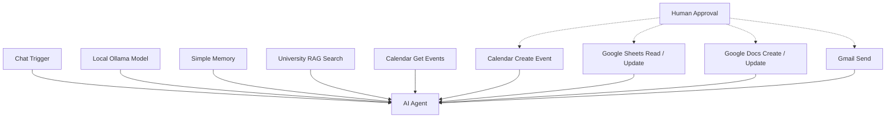

# Lab 06 — Building a Tool-Using AI Agent with Ollama

**Module:** PUSL3205 — Large Language Models and Generative AI  
**Practical:** Lab Sheet 06  
**Development environment:** Windows, Python, VS Code, Ollama, LangChain, SQLite, Google Calendar API, Docker and n8n  
**Local language model:** `llama3.2:3b`


## 1. Laboratory objective

In this lab I explored what happens when a local language model is allowed to use tools instead of only generating text. The practical started with a calculator, then introduced persistent memory, document retrieval and Google Calendar. The last part moved to n8n, where the same idea can be expressed as a visual workflow.

The main things I wanted to understand were how an agent chooses a tool, how the result comes back to the model, and what extra checks are needed when a tool can access files or change something in an external account.

The lab sheet is organised into **Parts A–E** and a final **Intelligent University Assistant** exercise. The final exercise extends the n8n agent to university RAG, Google Calendar, Google Sheets, Google Docs and Gmail.

## 2. Tools and environment

| Tool | How I used it |
|---|---|
| Python | Wrote the agent loops and local tools |
| Ollama / `llama3.2:3b` | Ran an instruction-following language model locally |
| LangChain | Defined tools, connected them to the model and handled tool calls |
| PyAutoGUI / PyGetWindow | Used in the Windows Calculator automation |
| SQLite | Stored facts that could be retrieved later |
| ChromaDB / Lab 05 RAG | Retrieved passages from a university knowledge base |
| Google Calendar API | Read events and created events using OAuth authentication |
| Docker / n8n | Built a visual chat-agent workflow |

I have not included my Python virtual environment in the intended GitHub submission. It can be recreated locally and is not part of the source code. Likewise, Google OAuth credentials and access tokens must remain private.

## 3. Part A — Calculator agent

I started by connecting `llama3.2:3b` to a calculator tool through LangChain. The agent receives a natural-language calculation request, decides whether to call the tool and returns its result. The Python implementation also includes logic for opening and interacting with Windows Calculator.

**Source file:** [`src/part_a_calculator/calculator_agent.py`](src/part_a_calculator/calculator_agent.py)

One recorded test was:

```text
Question: Calculate 5 * 4
Result: 64
```

### Part A extension — Five additional tools

The lab sheet also asks for **Date and Time, Notepad, File Search, File Creation and System Information**, in addition to the calculator. These are part of the required exercise, but the original submitted Lab 06 archive does not include their implementation or test outputs. They should not be marked complete on the strength of the calculator demonstration alone.


## 4. Part B — Giving the agent memory

The next step was to add memory using SQLite. Without storage, a model may lose a fact after a new session begins. A database gives the agent a way to save information and look it up later.

**Source file:** [`src/part_b_memory/memory_agent.py`](src/part_b_memory/memory_agent.py)


## 5. Part C — RAG-powered AI agent

For Part C, I connected the agent to university-document retrieval, building on Lab 05. This version has three tool types: calculator, memory search and university knowledge search.

**Source file:** [`src/part_c_rag_agent/rag_agent.py`](src/part_c_rag_agent/rag_agent.py)

When asked a university question, the agent calls the retrieval tool rather than relying only on facts that might be present in the language model's training data. The recorded test returned a passage from the university knowledge base about an academic programme.


## 6. Part D — Google Calendar integration

I then connected an agent to Google Calendar using the Google Calendar API and OAuth. This introduced a different kind of tool: instead of just calculating or searching, the agent could interact with information in an external account.

**Source file:** [`src/part_d_google_calendar/calendar_agent.py`](src/part_d_google_calendar/calendar_agent.py)

Two operations were implemented:

- **Check today's schedule:** Retrieve events from the connected calendar.
- **Create an event:** Prepare an event from the requested title and time, then create it after confirmation.

The submitted screenshots show a schedule lookup and a calendar-event creation flow with a successful result.


## 7. Part E — Building an AI agent in n8n

In the last part, I used Docker to run n8n and built a workflow around the local Ollama model. Instead of implementing every connection in Python, n8n lets the components be connected visually.

The documented workflow includes:

- **When chat message received:** Accepts user requests.
- **AI Agent:** Decides how to respond and whether to use a tool.
- **Ollama Chat Model:** Uses the local Llama 3.2 model.
- **Simple Memory:** Supplies recent conversational context.
- **Google Calendar — Create an event:** A tool connected to the agent.

The Docker-to-Windows Ollama connection uses `http://host.docker.internal:11434`.


### What is still needed in n8n

The lab sheet shows **both Google Calendar event retrieval and creation**. The submitted n8n workflow evidence does not show a connected **Get Many Events** tool. It also does not show a human-approval step on the Calendar creation tool. Both should be added and tested.

No exported n8n workflow JSON was included in the original archive. A JSON export would help demonstrate the exact nodes and connections without relying only on screenshots.

## 8. Final exercise — Intelligent University Assistant

The final exercise asks for a more complete agent that can answer university questions, manage calendars, work with student records, generate documents and send notifications.

| Lab-sheet feature | Evidence in the current submission |
|---|---|
| Chat interface | n8n Chat Trigger connected |
| Local AI agent | Ollama and AI Agent connected |
| Conversation memory | Simple Memory connected |
| University information through RAG | Demonstrated in Python Part C; **not yet integrated into n8n** |
| Check Google Calendar | Demonstrated in Python Part D; **not yet demonstrated as an n8n tool** |
| Create Google Calendar event | Demonstrated in Python; n8n create tool connected, latest execution not verified |
| Read and update Google Sheets | Not demonstrated |
| Generate a Google Docs document | Not demonstrated |
| Send a Gmail notification | Not demonstrated |
| Approval for external write actions | Python Calendar confirmation shown; n8n approval configuration not demonstrated |

This is the main unfinished part of the lab. I would not describe the current n8n workflow as the complete Intelligent University Assistant yet.

### Target workflow




## 9. Challenges and observations

The most noticeable difference between an ordinary chatbot and this agent was the **tool execution cycle**: the model identifies the task, requests a tool, receives its output and then produces a response. I found this easier to understand when the terminal displayed the selected tool and arguments.

Adding memory made the interaction more useful, but it introduced a question of *what should be remembered*. Not every chat message belongs in a permanent database, especially if it contains private details.

RAG made the agent less dependent on the model's own knowledge. At the same time, it showed a new failure point: the answer is only as useful as the documents and chunks retrieved. If the wrong passage is selected, the final answer may still be wrong.

Google Calendar and n8n introduced configuration work that wasn't present in the calculator experiment. OAuth credentials, Docker networking, tool descriptions and time-zone settings all mattered. I also learned that **a connected node is not the same as a successful execution**. The final workflow needs tests of each service, including checks that rejected write actions make no changes.

## 10. Learning outcomes

From the parts I implemented and tested, I learned how to:

- Connect a local Ollama model to LangChain tools.
- Handle a model's tool-call request and return the tool result.
- Use SQLite for information that needs to persist beyond one message.
- Combine a calculator, memory retrieval and university-document retrieval in one agent.
- Access Google Calendar using OAuth and distinguish read operations from write operations.
- Assemble a basic AI Agent workflow in n8n using Ollama and Simple Memory.
- Check the evidence behind an answer instead of accepting an apparently confident response.
- Recognise the difference between implemented source code, a connected workflow and a verified successful execution.

The unfinished final exercise also made clear what additional integration work would be required to build a complete university administration assistant.


## 11. Conclusion

This lab gave me practical experience with local AI agents beyond ordinary question answering. I was able to test a calculator agent, explore persistent memory, retrieve university information through RAG and use Google Calendar from a Python agent. I also built the core of an n8n chat workflow using Ollama and memory.

The most important lesson was that building an agent is not only about getting the language model to respond. The tools need to perform the intended action, the evidence has to be checked, and anything that changes external data needs sensible controls.


## 12. References and academic integrity

- PUSL3205. *Lab Sheet 06 — Building a Tool-Using AI Agent with Ollama*. Module-provided practical sheet.
- [Ollama documentation](https://docs.ollama.com/)
- [LangChain documentation](https://docs.langchain.com/)
- [Python SQLite documentation](https://docs.python.org/3/library/sqlite3.html)
- [Google Calendar API documentation](https://developers.google.com/workspace/calendar/api/guides/overview)
- [n8n documentation](https://docs.n8n.io/)
