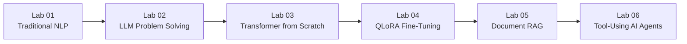

# PUSL3205 — Large Language Models and Generative AI

### Individual Practical Portfolio | Laboratory Sessions 01–06

**Repository:** [HesaraDi531/PUSL3205-Practical-Portfolio](https://github.com/HesaraDi531/PUSL3205-Practical-Portfolio)  
**Module:** PUSL3205 — Large Language Models and Generative AI  
**Development environments:** Google Colab and Visual Studio Code (Windows)  
**Primary language:** Python

---

## Overview

This repository documents my work across six practical sessions in **Large Language Models and Generative AI**. The labs progress from traditional text classification to building a small Transformer, adapting a pretrained language model, retrieving knowledge from documents, and connecting a local LLM to tools and automated workflows.

I have organised the work into separate folders so that the implementation, experiment outputs, screenshots, and observations for each session can be reviewed independently. Alongside the successful results, the individual lab reports also discuss practical limitations and work that has not yet been fully demonstrated.

## Laboratory index

| Lab | Practical | Main technologies | Documentation |
|:--:|---|---|---|
| **01** | Sentiment Analysis Using Traditional Machine Learning | Pandas, NLTK, Scikit-learn, BoW, TF-IDF | [Lab 01 README](Lab-01-Machine-Learning/README.md) |
| **02** | AI in Everyday Challenges — *The Busy Student* | LLM-assisted ideation, problem solving, reflection | [Lab 02 README](Lab-02-LLM-Everyday-Life/Lab-02-README.md) |
| **03** | Developing a Tiny Transformer Language Model | Python, PyTorch, TinyStories | [Lab 03 README](Lab-03-Tiny-Transformer/Lab-03-README-Final.md) |
| **04** | Fine-Tuning an LLM Using LoRA/QLoRA | Hugging Face, PEFT, TRL, Qwen 2.5, bitsandbytes | [Lab 04 README](Lab-04-LoRA-Fine-Tuning/README.md) |
| **05** | RAG Architecture — University Knowledge Assistant | LangChain, Ollama, ChromaDB, Streamlit | [Lab 05 README](Lab-05-RAG-Architecture/README.md) |
| **06** | Building a Tool-Using AI Agent with Ollama | LangChain, SQLite, Google Calendar, Docker, n8n | [Lab 06 README](Lab-06-AI-Agents/README.md) |

## Lab 01 — Sentiment Analysis Using Traditional Machine Learning

**Objective:** Build and evaluate a binary sentiment classifier using conventional natural language processing techniques.

I worked with the [UCI Sentiment Labelled Sentences dataset](https://archive.ics.uci.edu/dataset/331/sentiment+labelled+sentences), combining IMDb, Amazon and Yelp reviews. I inspected the text, cleaned and normalised it, explored sentiment distributions and frequent words, and compared **Bag-of-Words** and **TF-IDF** features with **Logistic Regression** and **Linear Support Vector Machine (SVM)** classifiers. The selected model was evaluated on a held-out test set, and I also tested predictions on new sentences.

**Recorded results:**

| Measure | Result |
|---|---:|
| Original reviews | 3,000 |
| Reviews after cleaning and deduplication | 2,970 |
| Training / test records | 2,376 / 594 |
| Selected model | TF-IDF + Linear SVM |
| Held-out test accuracy | **85.02%** |
| Macro F1-score | **85.01%** |

**Evidence:** [Notebook](Lab-01-Machine-Learning/notebooks/LabSheet_1.ipynb) · [Experiment summary](Lab-01-Machine-Learning/results/experiment-summary.json) · [Model comparison](Lab-01-Machine-Learning/results/model-comparison.csv) · [Confusion matrix](Lab-01-Machine-Learning/results/confusion-matrix.png)

**Key learning:** Text representation, preprocessing decisions and careful evaluation affect the performance of traditional NLP classifiers. Some short or negated sentences remain difficult for a bag-of-features approach.

## Lab 02 — AI in Everyday Challenges: The Busy Student

**Objective:** Explore how an LLM can support creative problem solving and early-stage product development for a real student need.

For **Group 5 — The Busy Student**, I examined the difficulty of managing lectures, assignments, group projects, deadlines, independent study and personal commitments. The activity focused on defining user needs and considering a product concept, target users, core features and possible interface design, with an LLM acting as an ideation partner.

The uploaded deliverable is a **learning and reflection README**, not a deployed software application. It discusses prompt clarity, prioritisation, user-centred thinking, collaboration and the need to evaluate AI suggestions critically. The lab sheet also calls for a visual mock-up and short group presentation; those are not included as separate artifacts in this repository.

**Evidence:** [Group 5 activity and reflection](Lab-02-LLM-Everyday-Life/Lab-02-README.md)

**Key learning:** LLMs can help generate and refine ideas, but the usefulness and feasibility of a product still require human judgement and user feedback.

## Lab 03 — Developing a Tiny Transformer Language Model

**Objective:** Understand next-token prediction by implementing and training a compact Transformer rather than using a ready-made generative model.

I used **1,500 stories** from [TinyStories](https://huggingface.co/datasets/roneneldan/TinyStories), created a character-level vocabulary and input–target sequences, and implemented a decoder-only Transformer with token/positional embeddings, masked multi-head attention, feed-forward layers, residual connections and layer normalisation. I tracked training and validation loss, generated sample stories and compared different model depths.

**Recorded model comparison:**

| Experiment | Layers | Validation loss | Perplexity |
|---|---:|---:|---:|
| Baseline | 2 | **2.0697** | **7.9222** |
| Deeper model | 3 | **2.0227** | **7.5585** |

Both experiments used four attention heads and six training epochs. In the notebook, each epoch consists of a limited set of randomly sampled mini-batches; these figures should not be interpreted as training on the entire TinyStories corpus.

**Evidence:** [Notebook](Lab-03-Tiny-Transformer/notebooks/LabSheet_3.ipynb) · [Model comparison](Lab-03-Tiny-Transformer/results/07-model-comparison.csv) · [Loss graph](Lab-03-Tiny-Transformer/results/03-training-validation-loss.png) · [Saved models](Lab-03-Tiny-Transformer/saved-model/)

**Key learning:** Attention masking, sequence preparation and training configuration are fundamental to autoregressive text generation. A deeper network improved validation loss within this small experiment, although generated text quality was still limited.

## Lab 04 — Fine-Tuning an LLM Using LoRA/QLoRA

**Objective:** Adapt a small instruction-tuned language model to a custom domain using parameter-efficient fine-tuning.

I used **Qwen/Qwen2.5-0.5B-Instruct** on a **Tesla T4 GPU** in Google Colab. The experiment used a fictional computer-shop knowledge domain, with **40 training** and **4 validation** question–answer examples. The base model was loaded using 4-bit quantisation and adapted with **QLoRA** through PEFT and TRL. I compared the original and adapted model on **10 unseen test questions** and saved the trained adapter.

**Recorded results:**

| Measure | Result |
|---|---:|
| Fine-tuning method | QLoRA (4-bit) |
| Training epochs | 10 |
| Reported training loss | **0.7887** |
| Best validation loss | **1.0221** (epoch 7) |
| Final validation loss | **1.0382** |

The training run completed, but lower loss did not guarantee correct answers. The before-and-after comparison records both improvements and unsupported or inconsistent responses. The shop facts are fictional and should not be treated as real commercial policies.

**Evidence:** [Notebook](Lab-04-LoRA-Fine-Tuning/notebooks/LabSheet_4.ipynb) · [Experiment summary](Lab-04-LoRA-Fine-Tuning/results/experiment-summary.json) · [Before/after comparison](Lab-04-LoRA-Fine-Tuning/results/original-vs-finetuned.csv) · [Saved adapter](Lab-04-LoRA-Fine-Tuning/saved-adapter/)

**Key learning:** LoRA and quantisation make small-domain fine-tuning more accessible, but data quality, compatibility between libraries and evaluation on unseen questions are essential.

## Lab 05 — RAG Architecture: University Knowledge Assistant

**Objective:** Build an assistant that answers university-related questions using retrieved document content instead of relying only on the LLM's internal knowledge.

I implemented a local **Retrieval-Augmented Generation (RAG)** pipeline using **Llama 3.2 3B** through Ollama, **Qwen3 Embedding 0.6B**, **ChromaDB** and **LangChain**. The pipeline loads documents, extracts and chunks their text, stores embeddings, retrieves relevant passages and generates answers with source references. A **Streamlit** interface provides a document-upload and question-answering experience.

**Recorded ingestion result:**

| Measure | Result |
|---|---:|
| University handbook indexed | 1 PDF |
| Text pages | **20** |
| Indexed chunks | **45** |
| Ingestion warnings | **0** |

The submitted screenshots demonstrate indexing and question answering with one handbook. The code includes support for additional document uploads, but a separate multi-PDF test is not documented. A completed quantitative RAG benchmark and the advanced group RAG comparison requested later in the lab sheet are not included.

**Evidence:** [RAG implementation](Lab-05-RAG-Architecture/src/) · [Streamlit application](Lab-05-RAG-Architecture/app.py) · [Ingestion summary](Lab-05-RAG-Architecture/results/ingestion_summary.json) · [Screenshots](Lab-05-RAG-Architecture/screenshots/)

**Key learning:** The relevance and coverage of retrieved chunks are critical to answer quality. Keeping source filenames and page references improves transparency, but citations still need to be verified against the original documents.

## Lab 06 — Building a Tool-Using AI Agent with Ollama

**Objective:** Extend a local language model with tools, persistent memory, university-document retrieval and external-service operations, then explore automation through n8n.

The Python project includes a LangChain agent loop using **Ollama (`llama3.2:3b`)**, a Windows Calculator tool and five additional desktop utilities: date/time lookup, Notepad writing, file search, text-file creation and system information. Further programs introduce **SQLite memory**, **Lab 05 RAG retrieval**, and **Google Calendar** event retrieval/creation using OAuth. A separate local RAG bridge is provided for connecting document search to external workflow tools.

The repository also documents an **n8n chat workflow** with Chat Trigger, Ollama Chat Model, Simple Memory and a Google Calendar Create Event tool. The available evidence does **not** establish that the full final n8n university assistant is complete. In particular, a tested n8n Calendar **Get Many Events** action, n8n-based university RAG, Google Sheets read/update, Google Docs generation, Gmail notifications, human approval for external writes, and an exported workflow JSON are not currently demonstrated in the repository.

**Evidence:** [Calculator entry point](Lab-06-AI-Agents/part_a_calculator.py) · [Multiple-tool agent](Lab-06-AI-Agents/part_a_multiple_tools.py) · [Memory agent](Lab-06-AI-Agents/part_b_memory.py) · [RAG agent](Lab-06-AI-Agents/part_c_rag.py) · [Calendar agent](Lab-06-AI-Agents/part_d_calendar.py) · [Agent tool implementations](Lab-06-AI-Agents/src/) · [Screenshots](Lab-06-AI-Agents/screenshots/)

**Key learning:** Tool-using agents require more than plausible language-model outputs. Each tool call needs validation, and operations that modify files or external accounts should be explicitly approved and tested.

---

## Progression across the six labs



The later practicals build on concepts from earlier sessions: Lab 03 explains the architecture behind language models, Lab 04 examines adapting a pretrained model, Lab 05 adds external document knowledge, and Lab 06 gives a model access to tools and workflows.

## Repository structure

```text
PUSL3205-Practical-Portfolio/
├── README.md
├── .gitignore
├── Lab-01-Machine-Learning/
│   ├── README.md
│   ├── dataset/
│   ├── notebooks/
│   ├── results/
│   └── screenshots/
├── Lab-02-LLM-Everyday-Life/
│   └── Lab-02-README.md
├── Lab-03-Tiny-Transformer/
│   ├── Lab-03-README-Final.md
│   ├── dataset/
│   ├── notebooks/
│   ├── results/
│   ├── saved-model/
│   └── screenshots/
├── Lab-04-LoRA-Fine-Tuning/
│   ├── README.md
│   ├── dataset/
│   ├── notebooks/
│   ├── results/
│   ├── saved-adapter/
│   └── screenshots/
├── Lab-05-RAG-Architecture/
│   ├── README.md
│   ├── app.py
│   ├── src/
│   ├── data/
│   ├── results/
│   └── screenshots/
└── Lab-06-AI-Agents/
    ├── README.md
    ├── part_a_calculator.py
    ├── part_a_multiple_tools.py
    ├── part_b_memory.py
    ├── part_c_rag.py
    ├── part_d_calendar.py
    ├── rag_bridge.py
    ├── src/
    └── screenshots/
```


## Results, evidence and limitations

The figures reported above come from the saved notebook outputs and result files in this repository. For a closer inspection, each laboratory includes its own explanation of methods, screenshots and observed problems. In particular:

- **Lab 02** is a reflective group-activity record, not a software deployment.
- **Lab 04** records a completed fine-tuning run, but a low training loss is not a proof of factual reliability.
- **Lab 05** demonstrates a single-document RAG workflow; advanced retrieval comparisons and quantitative evaluation are not yet provided.
- **Lab 06** includes tool implementations and a partial n8n workflow, but the complete multi-service assistant requires further integration and execution evidence.

Files such as Python virtual environments, OAuth credentials, local tokens, private `.env` files and regenerated ChromaDB data are intentionally excluded from version control. **Do not commit real student records or private Google account credentials.**

## What I learned

These six practicals helped me connect the underlying concepts of LLMs with the real implementation challenges: cleaning text before classification, managing sequence data for Transformers, training efficiently with adapters, retrieving reliable external evidence, and controlling tool calls that can interact with a user's environment. I also learned to separate **code that exists**, **experiments that were executed** and **features that still require testing**. That distinction is essential when reporting experimental results responsibly.

## Overall conclusion

Completing these six laboratories helped me understand how language AI systems develop from basic text processing into applications that can generate content, retrieve information and use external tools. Each lab introduced a different part of that progression, and the practical work showed me why implementation and evaluation are just as important as the underlying theory.

In **Lab 01**, I learned how preprocessing, feature extraction and conventional classifiers can produce useful sentiment predictions, with the selected TF-IDF and Linear SVM model achieving **85.02% test accuracy**. **Lab 02** shifted the focus from modelling to problem-solving: the *Busy Student* activity showed how an LLM can support idea generation while leaving feasibility and user needs to human judgement. In **Lab 03**, building a small Transformer from scratch clarified how attention, next-token prediction and training settings influence text generation; the three-layer experiment improved validation loss and perplexity compared with the two-layer baseline. **Lab 04** demonstrated how QLoRA can adapt a pretrained model using limited GPU resources, while also showing that a decreasing training loss does not guarantee dependable answers to unseen questions.

The final two labs brought these concepts closer to practical applications. In **Lab 05**, I connected document ingestion, embeddings, ChromaDB retrieval and a local LLM to answer questions from a university handbook, indexing **20 pages into 45 chunks**. In **Lab 06**, I explored agents that can use calculators, memory, document retrieval and calendar tools, and began connecting these capabilities through n8n. The full n8n university assistant, including Sheets, Docs, Gmail and approved write actions, still needs complete end-to-end testing and supporting evidence.

Overall, the portfolio strengthened my understanding of NLP, Transformers, efficient fine-tuning, RAG and AI-agent workflows. It also taught me to examine errors, protect credentials, verify results against evidence and distinguish a working demonstration from a fully evaluated system. These lessons provide a foundation for developing more reliable, useful and responsible LLM applications in future projects.

## References and acknowledgements

- [UCI Sentiment Labelled Sentences](https://archive.ics.uci.edu/dataset/331/sentiment+labelled+sentences)
- [TinyStories dataset](https://huggingface.co/datasets/roneneldan/TinyStories)
- [PyTorch documentation](https://pytorch.org/docs/stable/index.html)
- [Hugging Face Transformers](https://huggingface.co/docs/transformers/index) and [PEFT](https://huggingface.co/docs/peft/index)
- [LangChain documentation](https://docs.langchain.com/)
- [Ollama](https://ollama.com/), [Streamlit](https://docs.streamlit.io/) and [n8n](https://docs.n8n.io/)

